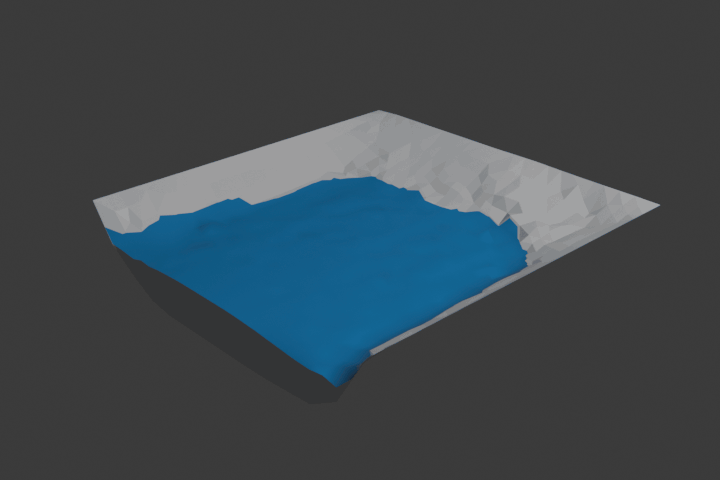

# flow
Simple shallow water simulation code (based on doi: 10.1016/j.cma.2009.08.006) and scripts for animating water flows in Blender.

To run the `.blend` tests:
```
blender --background blend/river_test.blend --python examples/export_river.py
./build/flow examples/river.cfg
blender --background --python examples/import_river.py
```
and
```
blender --background blend/wave_test.blend --python examples/export_wave.py
./build/flow examples/wave.cfg
blender --background --python examples/import_wave.py
```

 
